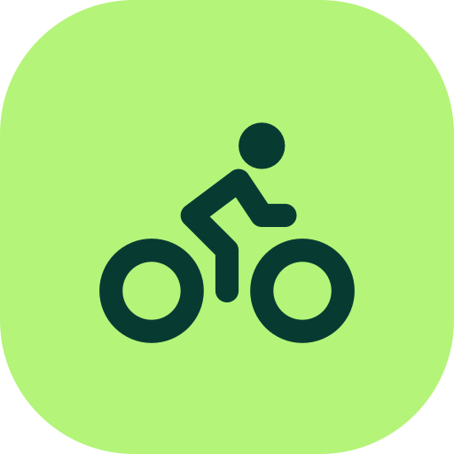

<p align="center">
  
</p>

# Fietsroutes Vlaanderen


[](https://github.com/MGeurts/fietsroutes/releases/latest)

[](https://www.paypal.me/MGeurtsKREAWEB)
[](https://buymeacoffee.com/MGeurts)

Repository: [MGeurts/fietsroutes](https://github.com/MGeurts/fietsroutes).

Webapp om fietsroutes op het officiële Vlaamse knooppuntennetwerk te plannen, te bewaren en op een smartphone te volgen. Gebouwd met React, TypeScript, Vite en Leaflet.

## Documentatie

- [Releasebeschrijving v1.1.0](docs/RELEASE-v1.1.0.md).
- [Releasebeschrijving v1.0.2](docs/RELEASE-v1.0.2.md).
- [Releasebeschrijving v1.0.1](docs/RELEASE-v1.0.1.md).
- [Releasebeschrijving v1.0.0](docs/RELEASE-v1.0.0.md).

- [Gebruikershandleiding](docs/GEBRUIK.md): plannen, kaartbediening, rondritten, bibliotheek, GPX en fietsmodus.
- [Ontwikkelaarsdocumentatie](docs/ONTWIKKELING.md): architectuur, netwerkimport, controles, hosting, privacy en beperkingen.
- [Publiceren op Antagonist Slim](docs/ANTAGONIST.md): productie zonder Node.js, upload, HTTPS en updates.
- [Updates automatiseren](docs/UPDATES.md): automatische ZIP, volledige dataverversing en opties voor periodieke updates.

## Productie: Antagonist Slim zonder Node.js

De productieomgeving is **Antagonist.nl shared hosting, pakket Slim**. De app draait daar als statische website. Node.js en npm zijn uitsluitend nodig op de ontwikkelcomputer of in CI om te bouwen; op de hosting draaien geen Node-server, npm-proces, database of achtergrondtaken voor deze app.

Upload de **inhoud** van `dist/`, inclusief `.htaccess`, naar de documentroot van een eigen domein of subdomein. De browser voert de app uit en gebruikt de externe kaart-, zoek- en routeringsdiensten rechtstreeks. De [publicatiehandleiding](docs/ANTAGONIST.md) bevat de volledige stappen en controles.

De release gebruikt HTTPS en stuurt HTTP via `.htaccess` door naar HTTPS. Activeer vooraf een geldig SSL-certificaat op het productiedomein. Het versienummer staat in de informatiemodal en komt uit `package.json`.

## Lokaal starten

Voor lokale ontwikkeling gebruiken we **[Flock](https://flockphp.com/)** als PHP-/webserveromgeving en beheerder van de lokale PHP- en Node.js-versies. Gebruik Node.js 26 en npm voor de bouwopdrachten. Flock serveert dit project op **https://fietsroutes.test**; `.flockrc` stelt de documentroot in op `dist/`.

```powershell
npm ci
npm run build
```

Na wijzigingen opnieuw bouwen en de pagina herladen. Wanneer de browser een vorige appversie blijft tonen, herlaad met **Ctrl+Shift+R**. Bewaarde routes blijven daarbij behouden; verwijder hiervoor geen browseropslag.

Elke geslaagde `npm run build` maakt via `postbuild` automatisch `releases/fietsroutes-antagonist.zip`. Het bestaande archief wordt vervangen nadat de nieuwe ZIP-inhoud is gecontroleerd. Een mislukte build werkt de ZIP niet bij.

Controleer de Flock-configuratie indien nodig:

```powershell
flock pin root dist
npm run check:host
```

Met Flock is geen afzonderlijk serverproces nodig om de gebouwde app te openen. `npm run dev` (Vite met live herladen) en `npm run preview` zijn alternatieven voor ontwikkeling zonder Flock. Een echte smartphone heeft een bereikbaar HTTPS-adres nodig voor GPS en installatie. Het lokale `.test`-adres is niet automatisch bereikbaar vanaf je mobiele telefoon.

## Huidige functies

- Drie kaartkeuzes via een modal: **Standard (OSM)**, **OSM + Fietsnetwerk** (standaard) en **CyclOSM**.
- Geolocatie bij opstart, een locatiepunt met nauwkeurigheidskring en een centreerknop boven de zoomselector. Het actuele zoomniveau staat in de selector; de kaartlagenknop staat eronder.
- Plaatsen zoeken via Photon/OpenStreetMap, inclusief gemeenten en dorpen zoals Zutendaal. Knooppuntnummers en netwerknamen worden lokaal doorzocht.
- Routes plannen via officiële aansluitingen, inclusief automatisch gekozen tussenpunten. De lijst toont alle genummerde bezoeken, met de fietsafstand en geschatte tijd tot het volgende punt.
- Vaste markeringen voor Start, manuele en automatische tussenpunten en Einde, consistent op kaart, in de lijst en in de volledige knooppuntvolgorde.
- **E-bike · 20 km/u** als standaard fietsprofiel. Ook stadsfiets, toerfiets en racefiets zijn beschikbaar voor de tijdsinschatting.
- Punten verwijderen, werkroute leegmaken, ongedaan maken/opnieuw, route omkeren en de volledige route centreren. De werkroute wordt lokaal automatisch hersteld na herladen; het logo wist de route niet.
- Vier rondritvoorstellen met een gewenste afstand, één per windrichting, met kaartvooruitzicht en keuze vóór toepassing. De standaardnaam begint met het startnummer, bijvoorbeeld `535 - Rondrit 32,2 km`.
- Knop **Suggestie** voor een gestructureerde routenaam, bijvoorbeeld `534 - Naar 64 - 25,3 km` of `534 - Rondrit - 32,2 km`.
- Lokale routebibliotheek met favorieten, zoeken, datum en tijd van de laatste bewaring, bijwerken, genummerde kopieën en JSON-backups.
- GPX-export met behoud van de decimale komma in bestandsnamen, herimport van eigen GPX, deellinks met QR-code en routenaam voor overdracht naar je mobiele telefoon en een afdrukbaar knooppuntenstrookje.
- Gestippelde fietsaanrijroute naar de start via BRouter, afzonderlijk van de geplande route en haar afstand/export.
- Fietsmodus met grotere rode positiestip, kaartrotatie met rijrichting bovenaan en schakelknop naar noorden bovenaan, GPS-volging, volgend en daaropvolgend knooppunt met afstand, compacte groene balk met actuele snelheid, resterende afstand en ETA, en melding bij afwijken of onnauwkeurige GPS. De ETA gebruikt het gekozen fietsprofiel. Na het bereiken van de start of bevestigde routevoortgang stopt de aanrijrouteberekening tijdens die rit.
- Installeerbare PWA met offline appbestanden en netwerkgegevens na een volledige eerste online installatie.

## Gegevens en beperkingen

De meegeleverde snapshot van 22 november 2026 bevat **5.138 netwerkpunten**, waarvan **5.002 genummerd**, en **7.655 bruikbare trajecten**, waarvan **80 éénrichtingstrajecten**. Het aantal knooppunten en trajecten staat in de informatiemodal. De bron is [Toerisme Vlaanderen en de provinciale toeristische organisaties](https://metadata.vlaanderen.be/srv/api/records/c91e9b9d-6465-4dec-beeb-16fdc6d759a0).

Eénrichtingstrajecten zijn opgenomen in de toegestane richting. De importer sluit onduidelijke of ongeldige aansluitingen, geometriefouten en onbekende of tegenstrijdige richtingscodes uit. Daardoor is nog niet elke officiële verbinding routeerbaar. De [ontwikkelaarsdocumentatie](docs/ONTWIKKELING.md#netwerkgegevens) beschrijft de controles en tellingen.

Kaarttegels, nieuwe plaatszoekopdrachten en het berekenen van aanrijroutes vereisen internet. GPX uit andere apps koppelen aan het knooppuntennetwerk, achtergrondnavigatie en gesproken afslagaanwijzingen zijn nog niet beschikbaar. De fietsmodus moet nog op echte Android- en iPhone-toestellen op de fiets worden getest.

De kaart gebruikt een ruimtelijke index en hergebruikt zichtbare lijnen, knooppuntmarkers en de locatiestip. Richtingspijlen worden per route en zoomniveau berekend en bij verschuiven hergebruikt. De knooppuntenlijst wordt niet opnieuw opgebouwd door GPS-updates. Het actuele versienummer staat links van de infoknop en onder de appnaam in de informatiemodal.

## Controles en onderhoud

```powershell
npm test
npm run build
npm audit
npm run check:host
```

`check:host` vereist een draaiende Flock-site. De geautomatiseerde tests controleren onder meer routering, de officiële snapshot, GPS, zoekopdrachten, knooppuntrollen, deelafstanden en tijden, bestandsnamen en kopienummering. GitHub Actions voert installatie, tests en build uit bij push en pull request.

```powershell
# Officiële netwerkgegevens opnieuw ophalen; daarna controleren en bouwen
npm run data:update

# Logo-export voor Windows, Linux en vectorgebruik
node scripts/export-logo.mjs
```

De logo-export schrijft `public/logo.ico` (16–256 px), `public/logo.png` (512 × 512) en `public/logo.svg`. Het bestaande `public/icon.svg` blijft het favicon/PWA-icoon.

`npm run data:refresh` vervangt alleen de lokale dataset. `npm run data:update` voert achtereenvolgens de refresh, tests en build inclusief ZIP uit. `package.json` gebruikt `^`-versiebereiken voor compatibele updates. `npm update` werkt afhankelijkheden binnen die bereiken bij en vernieuwt het lockbestand; `npm ci` installeert juist de vastgelegde versies uit het lockbestand. Updates worden dus niet tijdens het draaien van de app gedownload. `npm update` werkt alleen afhankelijkheden bij; voer daarna tests en een build uit. Geen van deze opdrachten uploadt automatisch naar Antagonist.

## Bronvermelding

- Netwerkgegevens: Toerisme Vlaanderen en de provinciale toeristische organisaties, <a href="https://data.vlaanderen.be/doc/licentie/modellicentie-gratis-hergebruik/v1.0" target="_blank" rel="noopener noreferrer">modellicentie voor gratis hergebruik</a>.
- Kaartgegevens: © <a href="https://www.openstreetmap.org/copyright" target="_blank" rel="noopener noreferrer">OpenStreetMap-bijdragers</a>, ODbL.
- Fietskaart: <a href="https://www.cyclosm.org/" target="_blank" rel="noopener noreferrer">CyclOSM</a>.
- Voor de openbare OSM-tegels geldt het <a href="https://operations.osmfoundation.org/policies/tiles/" target="_blank" rel="noopener noreferrer">tegelgebruiksbeleid</a>, dat offline bulkdownloads uitsluit.
